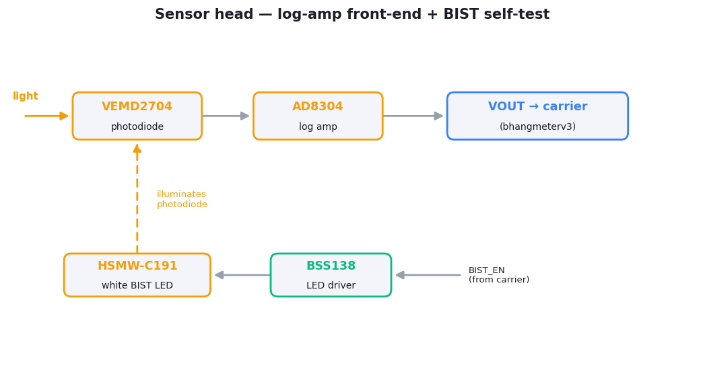

# BHG-3000 — optical sensor head

The optical front-end module for the [Bhangmeter V3](../../README.md). It is a
small daughterboard that converts incoming light into a voltage and plugs into
the [carrier board](../bhangmeterv3) via a board-to-board connector. Keeping it
separate lets the optical front-end be revised without re-spinning the carrier.

The signal chain is a **photodiode** feeding a **logarithmic transimpedance
amplifier**, plus a white **LED for built-in self-test** (BIST) — the firmware
flashes it to confirm the whole detection chain is alive before relying on it.

- **Size:** 20.1 × 12.5 mm, rounded rectangle (1 mm corner radius)
- **Layers:** 2 (top + bottom copper)
- **Project / Gerber name:** `hsn_V5`
- **Files:** [SCHEM.pdf](SCHEM.pdf) · [ASY.pdf](ASY.pdf) · [gerbers.zip](gerbers.zip)

## How it works

  <picture>
    <source media="(prefers-color-scheme: dark)" srcset="../../assets/sensorhead-dark.png">
    
  </picture>

A **logarithmic** amplifier (AD8304, ~160 dB / 8-decade range) is used so the
single front-end can span the enormous brightness ratio between the dim ambient
baseline and a saturating first pulse without changing gain ranges. The output
(`VOUT`) and `BIST_EN` cross the module connector to the carrier, where the
comparator and ADC do the timing and shape analysis.

## Connector (P1)

Two 7-pin strips, **Mill-Max `800-10-007-10-001000`** (14 pins in all), mating
with the `HSN-1000` socket (`U1`) on the carrier board. Four pins are used; the
3V3 rail is generated on this board and does not cross the connector.

| Pin | Signal |
|---:|---|
| 6 | `BIST_EN` — self-test enable, active high (10 kΩ pull-down) |
| 7 | `GND` |
| 11 | `VOUT` — log-amp output |
| 14 | `5V` supply in |
| 1–5, 8–10, 12, 13 | not connected |

## Bill of materials

From [ASY.pdf](ASY.pdf). Passives are 0402, except the 1 µF capacitors (0603).

| Designator(s) | Part | Qty | Description |
|---|---|---:|---|
| D1 | VEMD2704 | 1 | Silicon PIN photodiode — the optical sensor |
| IC2 | AD8304ARUZ | 1 | Logarithmic transimpedance amplifier (log converter) |
| IC1 | TLV70233DBVR | 1 | 3.3 V LDO regulator (5 V → 3V3) |
| DS1 | HSMW-C191 | 1 | White LED — BIST self-test source |
| Q1 | BSS138W-7-F | 1 | N-ch MOSFET — BIST LED driver |
| P1 | 800-10-007-10-001000 | 2 | Board-to-board connector (to carrier `U1`) — two 7-pin strips; the assembly BOM counts the footprint once |
| SB1 | SolderBridge | 1 | Bridges the LDO's input to its output — **leave open** (see below) |
| C1, C4, C6, C8, C9 | CGA2B3X7R1E104K050BB | 5 | 100 nF |
| C2, C3, C7, C10 | C0603C105K3RACTU | 4 | 1 µF |
| C5 | VJ0402A101GXBAC | 1 | 100 pF |
| C11 | CC0402KRX7R8BB102 | 1 | 1 nF |
| R2 | RC0402FR-0724K9L | 1 | 24.9 kΩ 1% — `VREF` → `VLOG`; sets slope and intercept |
| R3 | RC0402FR-0713K3L | 1 | 13.3 kΩ 1% — output buffer gain |
| R4 | RC0402FR-076K34L | 1 | 6.34 kΩ 1% — output buffer gain |
| R5 | RC0402FR-07160RL | 1 | 160 Ω 1% |
| R6 | RC0402FR-0710KL | 1 | 10 kΩ 1% |
| R7 | RC0402FR-07750RL | 1 | 750 Ω 1% |

> **`R1` (309 kΩ, `VLOG` → GND) is marked *Do Not Fit*** on the schematic —
> leave it unpopulated, even though the assembly BOM still lists it. `R2`, `R3`
> and `R4` together give the 246 mV/decade, ≈1 pA-intercept transfer quoted in
> the [project README](../../README.md#optical-front-end--dynamic-range);
> fitting `R1` would lower the slope slightly.

> **Leave `SB1` open.** Closing it ties the 5 V input straight to the 3V3 rail,
> bypassing the regulator. That raises the log amp's output swing above what the
> carrier's 3.3 V comparator and ADC inputs are meant to see.

## Assembly notes

- The connector `P1` and most decoupling are on the **top side**; the photodiode
  `D1`, log amp `IC2`, and BIST LED are on the **bottom side** — see
  [ASY.pdf](ASY.pdf) for exact placement.
- Mount `D1` so its active window faces the instrument's optical aperture; the
  white BIST LED should illuminate the same photodiode for the self-test to be
  meaningful.

See [../README.md](../README.md) for fabrication/ordering notes.
