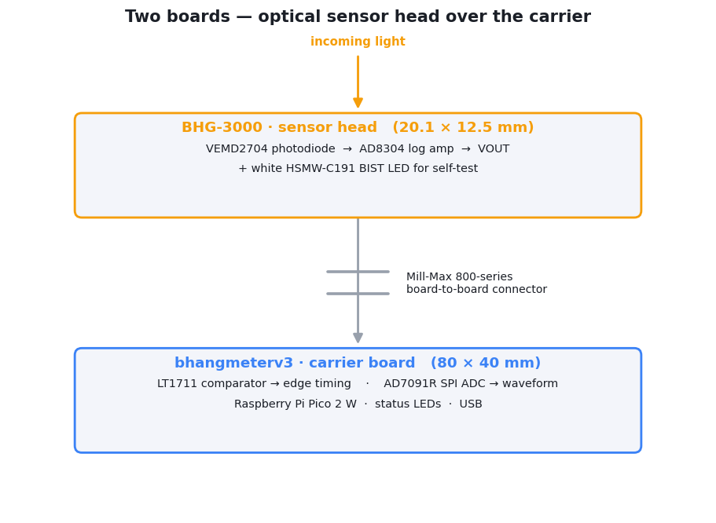

# PCB

Hardware design outputs for the **Bhangmeter V3** optical detector. For the
physics behind the instrument — the double-pulse signature and the yield maths —
see the [project README](../README.md). This folder is the electrical build:
schematics, assembly drawings, bills of materials, and fabrication Gerbers.

The instrument is **two boards** that connect through a board-to-board
connector — a small optical sensor head that plugs into a larger carrier board:

  <picture>
    <source media="(prefers-color-scheme: dark)" srcset="../assets/pcb-boards-dark.png">
    
  </picture>

## The two boards

| Board | Folder | Size | Role |
|---|---|---|---|
| **Main / carrier board** | [bhangmeterv3/](bhangmeterv3) | 80 × 40 mm | Carries the Raspberry Pi Pico 2 W and the read-out chain: comparator edge-detector, SPI ADC, status LEDs + BIST drive, power, USB, and the socket the sensor head plugs into. |
| **BHG-3000 sensor head** | [BHG-3000/](BHG-3000) | 20.1 × 12.5 mm | The optical front-end: photodiode + logarithmic transimpedance amplifier + a self-test LED, on a daughterboard that plugs into the carrier. |

Both are **2-layer** boards designed in Altium Designer. The sensor head is a
separate, swappable module so the optical front-end can be revised without
re-spinning the carrier.

## What's in each folder

| File | Contents |
|---|---|
| `Schematic.pdf` / `SCHEM.pdf` | Full schematic. |
| `Assembly.pdf` / `ASY.pdf` | Assembly drawing (top/bottom placement) **and** the bill of materials. |
| `gerbers.zip` | Fabrication package — copper, soldermask, paste, silkscreen, profile, and drill files (Gerber X2). |

See each board's `README.md` for its block diagram, BOM, and connector pinout.

## Ordering boards

The `gerbers.zip` in each folder is a complete fabrication package and can be
uploaded as-is to most fabricators (JLCPCB, PCBWay, OSHPark, Aisler, …):

- **Layers:** 2 (top + bottom copper).
- **Units:** millimetres; Gerber X2 with embedded attributes.
- **Drills:** supplied as **Gerber drill files** (`*_PTH_Drill.gbr`,
  `*_NPTH_Drill.gbr`) rather than Excellon `.drl` — every modern fab reads
  these, but select "Gerber" if asked about the drill format.
- **Board outline:** the `*_Profile.gbr` layer (rounded-rectangle outline).
- Board thickness, copper weight, and surface finish are **not** pinned in these
  files — use the fabricator's defaults (1.6 mm / 1 oz / HASL or ENIG) unless you
  have a reason to change them.

> Match the boards as a pair: the carrier (`bhangmeterV3`) and the
> sensor head (`hsn_V5`) are designed to mate. Order one of each.
