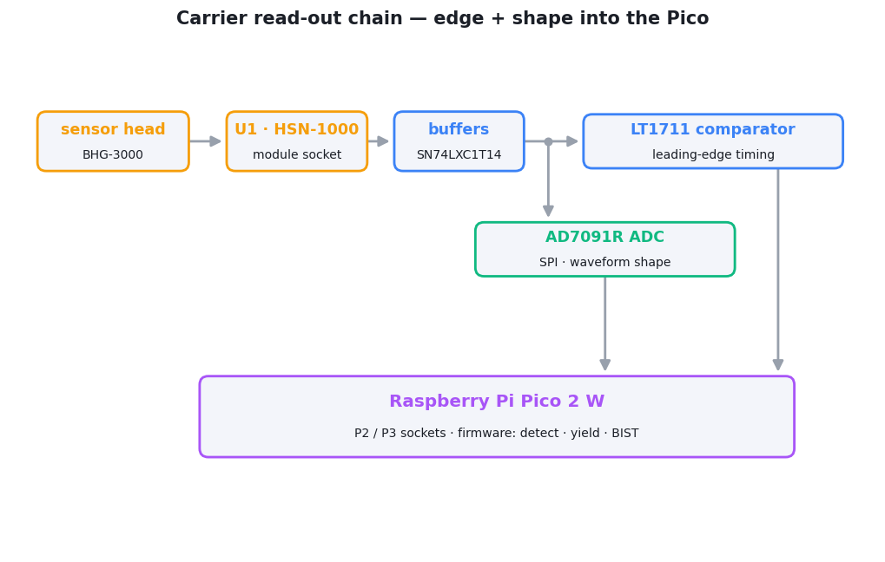

# bhangmeterv3 — main / carrier board

The carrier board for the [Bhangmeter V3](../../README.md). It hosts a
**Raspberry Pi Pico 2 W** and the analog read-out chain that turns the sensor
head's optical signal into the two timed quantities the firmware needs: a
**sub-µs leading edge** (comparator) and the **waveform shape** (ADC). The
[BHG-3000 sensor head](../BHG-3000) plugs into the module socket (`U1`).

- **Size:** 80 × 40 mm, rounded rectangle (4 mm corner radius)
- **Layers:** 2 (top + bottom copper)
- **Project / Gerber name:** `bhangmeterV3`
- **Files:** [Schematic.pdf](Schematic.pdf) · [Assembly.pdf](Assembly.pdf) · [gerbers.zip](gerbers.zip)

## Functional blocks

The schematic is organised into the sections below (matching the sheet labels):

| Section | Key parts | What it does |
|---|---|---|
| **USB + Raspberry Pi Pico** | `J1` USB3105-30-A, `P2`/`P3` 20-pin sockets | USB power/data in; sockets the Pico 2 W (RP2350) that runs the firmware. |
| **Module connector + buffers** | `U1` HSN-1000 socket, `U2`/`U3` SN74LXC1T14 | Mates the sensor head; buffers/level-shifts the signals coming back from it. |
| **Edge detector** | `U5` LT1711CMS8 comparator | Timestamps the fast leading edge of the first pulse, independent of amplitude. Threshold ≈1.03 V, set by `R18`/`R20` (2.21 k / 1 k from 3V3). The latch input is wired to the Pico but the firmware holds it transparent. |
| **ADC + power supply** | `U4` AD7091R (SPI ADC), `U6` ADP151-3.3 LDO | Digitises the analog waveform for peak/minimum/second-peak analysis; generates the 3V3 rail. |
| **BIST + LEDs** | `DS1/DS2/DS3` (W/G/R), `Q1–Q3` BSS138, `SW1` | Tri-colour status indication and the built-in self-test drive; user button. |

  <picture>
    <source media="(prefers-color-scheme: dark)" srcset="../../assets/carrier-dark.png">
    
  </picture>

## Bill of materials

From [Assembly.pdf](Assembly.pdf). Passives are 0603.

| Designator(s) | Part | Qty | Description |
|---|---|---:|---|
| U1 | HSN-1000 | 1 | Sensor-head module socket (mates with BHG-3000) |
| U2, U3 | SN74LXC1T14QDCKRQ1 | 2 | Single Schmitt-trigger buffer / level translator |
| U4 | AD7091RBRMZ | 1 | 12-bit SPI ADC — waveform capture |
| U5 | LT1711CMS8 | 1 | Fast comparator — leading-edge timing |
| U6 | ADP151ACPZ-3.3-R7 | 1 | 3.3 V LDO regulator |
| J1 | USB3105-30-A | 1 | USB connector |
| P2, P3 | 61302011121 | 2 | 20-pin header — Raspberry Pi Pico 2 W socket |
| DS1 | HSMW-C191 | 1 | White status LED |
| DS2 | HSMG-C190 | 1 | Green status LED |
| DS3 | HSMH-C190 | 1 | Red status LED |
| Q1, Q2, Q3 | BSS138 | 3 | N-ch MOSFET — LED drivers |
| SW1 | FSM4JSMATR | 1 | Tactile push-button |
| C1–C5, C7, C8, C10, C12, C17, C20 | 100 nF 50 V | 11 | Decoupling |
| C9, C11 | TACR106K016RTA | 2 | 10 µF tantalum |
| C13 | C0603C105K3RACTU | 1 | 1 µF |
| C14 | CC0603KRX5R9BB225 | 1 | 2.2 µF |
| C15 | VJ0603Y472KXBCW1BC | 1 | 4.7 nF |
| C18, C19 | GRM188R61E106MA73J | 2 | 10 µF |
| R2, R3, R8, R9, R10, R11, R17, R21 | RC0603FR-0710KL | 8 | 10 kΩ 1% |
| R5, R6, R7 | RC0603FR-07523RL | 3 | 523 Ω 1% (LED series) |
| R13, R14 | RC0603JR-070RL | 2 | 0 Ω (signal links: sensor output to comparator and ADC) |
| R16 | RC0603FR-0751RL | 1 | 51 Ω 1% (ADC input filter, with C15) |
| R18 | 2.21 kΩ 1% | 1 | Comparator threshold divider, top |
| R20 | RC0603FR-071KL | 1 | 1 kΩ 1% — comparator threshold divider, bottom |

> **Do not fit:** `C6`, `C16`, `R1`, `R4`, `R12`, `R15`, `R19`. They are marked
> *NO FIT* on the schematic and are absent from the assembly BOM. `R18` must be
> 2.21 kΩ, not 10 kΩ — it sets the comparator threshold.

## Module socket (U1)

`U1` is named for, and pinned like, the HSN-1000 nuclear event detector, so the
footprint keeps that part's signal names. The BHG-3000 uses four of the pins:

| U1 pin | Carrier net | BHG-3000 signal |
|---:|---|---|
| 6 | `BIST_BUFF` (from `U3`) | `BIST_EN` — high lights the self-test LED |
| 7 | `GND` | `GND` |
| 11 | `2ND_OUT` → comparator (`R13`) and ADC (`R14`) | `VOUT` — log-amp output |
| 14 | `5V` | `5V` |

The remaining pins are unused by the BHG-3000. The Pico pin assignments are
listed in the [firmware README](../../code/optical_bhang/README.md#pin-map).

## Assembly notes

- The Pico 2 W mounts on the **bottom side** into `P2`/`P3`; the USB connector,
  comparator, ADC, and LEDs are on the **top side** (see [Assembly.pdf](Assembly.pdf)).
- Fit the [BHG-3000 sensor head](../BHG-3000) into `U1` after both boards are
  built and tested.

See [../README.md](../README.md) for fabrication/ordering notes.
