# Bhangmeter V3

<p align="center">
  <picture>
    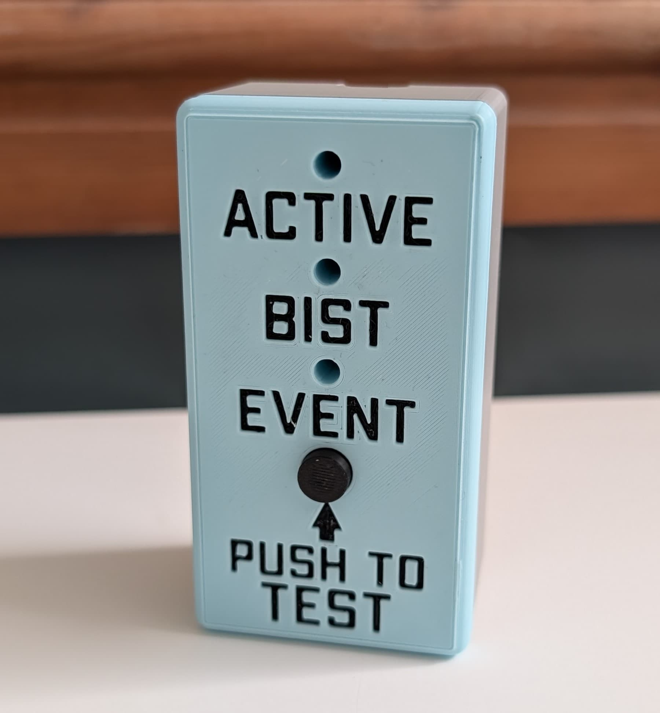
  </picture>
</p>

An open-source optical bhangmeter — a fast photodetector that recognises the
unique two-peaked light curve of a nuclear detonation and estimates its yield
from the timing of that signature. This repository holds the complete build:
firmware, host software, PCB, and enclosure.

> A bhangmeter estimates yield from the optical waveform alone. No other natural
> or artificial event reproduces the double-pulse signature, which makes the
> waveform both the detection trigger and the measurement.

A tour of the build, front to back:

<p align="center">
  <picture>
    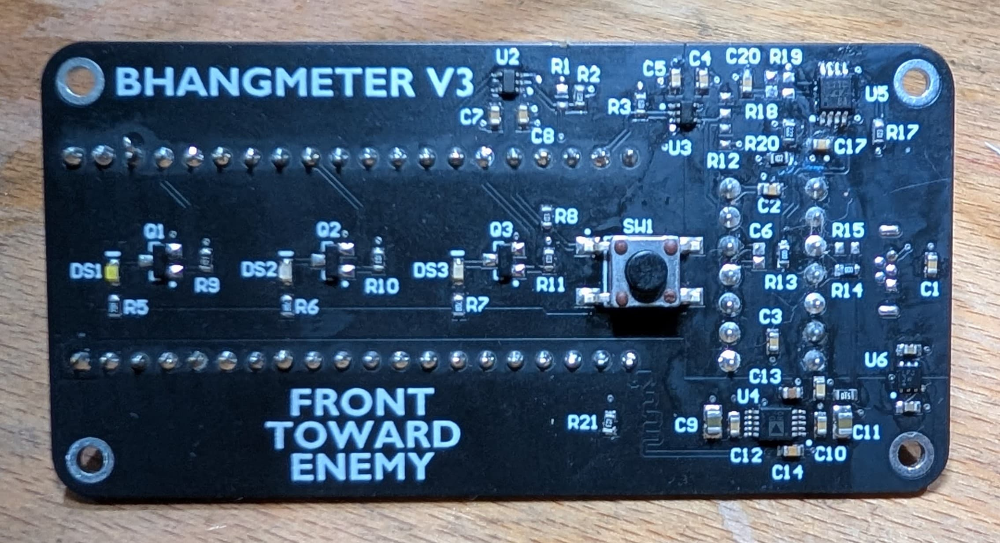
  </picture>
</p>

<p align="center"><em>Carrier board, front — the analogue signal chain: AD8304 log amp, LT1711 comparator for edge timing, and AD7091R ADC for waveform capture.</em></p>

<p align="center">
  <picture>
    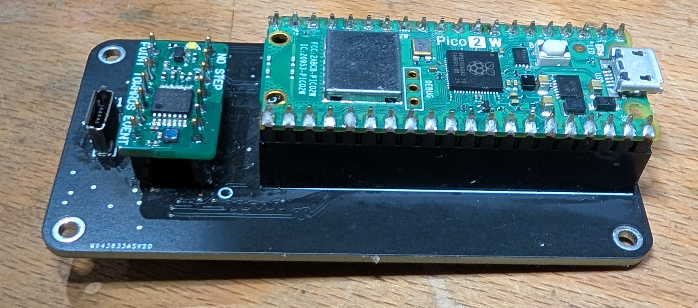
  </picture>
</p>

<p align="center"><em>Rear — the BHG-3000 optical sensor head and the RP2350 Pico 2 W (RP2W) that runs the firmware and handles WiFi upload.</em></p>

<p align="center">
  <picture>
    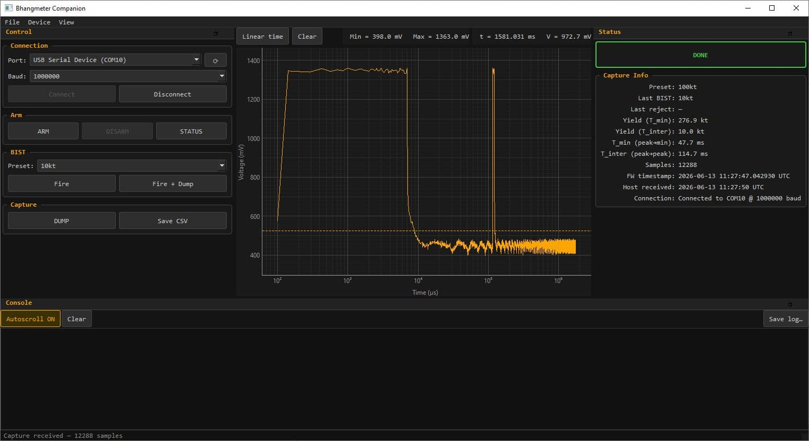
  </picture>
</p>

<p align="center"><em>The companion app — a PySide6 desktop console for driving the device, watching its state, and plotting captured waveforms.</em></p>

---

## The double-pulse signature

<p align="center">
  <picture>
    <source media="(prefers-color-scheme: dark)" srcset="assets/double-pulse-overlay-dark.png">
    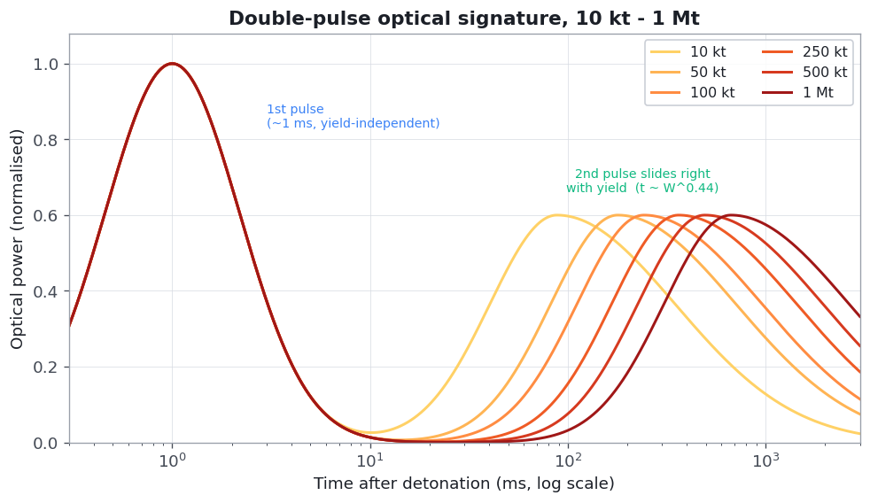
  </picture>
</p>

A high-yield fireball radiates ~35–45 % of its energy as light, but not
smoothly. Three phases produce two distinct optical peaks:

1. **First pulse — radiative fireball.** The fireball surface cools through
   ~10⁴ K and briefly shines bright in the visible — a ~10,000 K source, peaking
   in the UV (~290 nm) with a strong visible tail. Short (~1 ms) and nearly
   independent of yield — its timescale is set by air opacity, not energy.
2. **The minimum.** A hydrodynamic shock detaches and races ahead, ionising the
   air into an opaque shell that hides the (still hotter) interior. Visible
   emission drops about one order of magnitude (ten-fold) — the minimum sits
   at roughly 0.1 of the second-peak power, only ≈250 mV below the peaks on the
   log amp's output. The light never goes dark between the pulses; the dip is
   shallow (NWA FAQ §5; G&D Fig. 7.84).
3. **Second pulse — shock breakaway.** The shock cools below ~3000 K and turns
   transparent again, revealing a ~7500 K interior — near solar temperature, its
   blackbody peak ~380 nm with energy spread across the whole visible band. Lower
   peak, but it lasts hundreds of ms to seconds and carries ~99 % of the
   integrated thermal yield.

<p align="center">
  <picture>
    <source media="(prefers-color-scheme: dark)" srcset="assets/double-pulse-annotated-dark.png">
    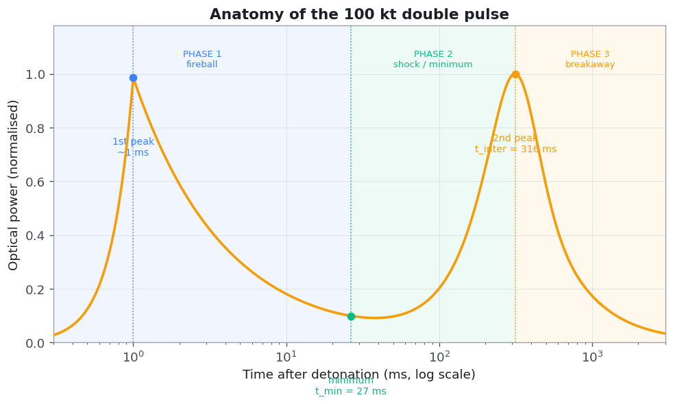
  </picture>
</p>

The gap between the two peaks scales with yield — and that gap is what the
instrument measures. The firmware uses standard low-altitude Glasstone & Dolan
scaling[^gd]:

```
t_inter ≈ 41.7·W^0.44 ms        t_min ≈ 1.87·W^0.576 ms
```

The two times scale with different exponents, so `t_min/t_inter` is **not** a
fixed 1/10 — it runs from ≈0.06 at 10 kt to ≈0.115 at 1 Mt. Inverting gives two
yield estimates, but they are not co-equal: `t_inter` is the primary estimator
— a sharp feature, and simulation against the literature waveforms recovers yield
to roughly ±15 % across 10 kt – 1 Mt at 5–20 km — while `t_min` is a coarse
cross-check. The minimum is a shallow, flat-bottomed feature, so its measured
time carries tens-of-percent uncertainty that the `W ∝ t^1.7` inversion amplifies.
Acceptance is therefore driven by `t_inter` alone; a `t_min` outside its (wide)
window does not reject the event, it only flags the result `T_MIN_SUSPECT`.

| Yield | T_min (peak→min) | T_inter (peak→peak) |
|---|---:|---:|
| 10 kt | 7 ms | 115 ms |
| 50 kt | 18 ms | 233 ms |
| 100 kt | 27 ms | 316 ms |
| 250 kt | 45 ms | 473 ms |
| 500 kt | 67 ms | 642 ms |
| 1 Mt | 100 ms | 871 ms |

The device reports a yield only when `t_inter` lands in its valid window,
90–1050 ms — i.e. the 10 kt – 1 Mt design envelope with slack. `t_min` has an
advisory window of 5–130 ms; outside it the yield is still reported, flagged
`T_MIN_SUSPECT`. (High-altitude bursts lack the hydrodynamic minimum and fall outside
this instrument's scope.)

<p align="center">
  <picture><source media="(prefers-color-scheme: dark)" srcset="assets/timing-vs-yield-dark.png">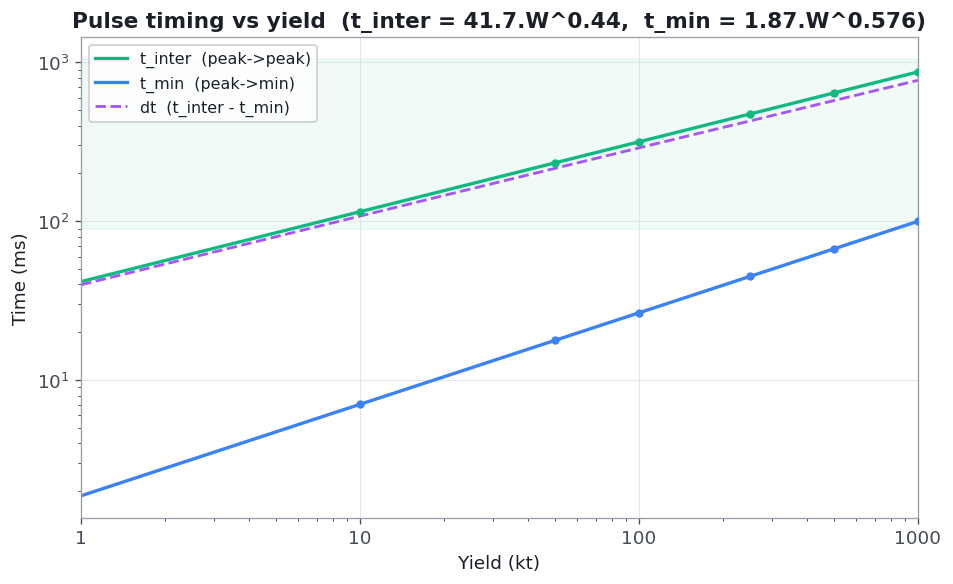</picture>
  <picture><source media="(prefers-color-scheme: dark)" srcset="assets/yield-from-tmin-dark.png">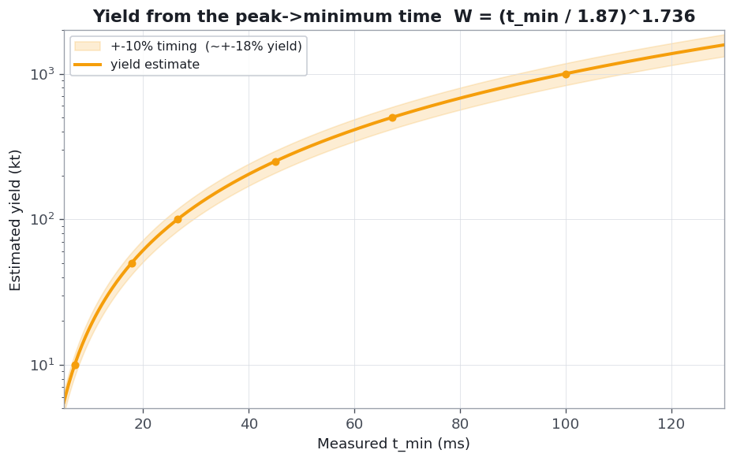</picture>
</p>

---

## How the instrument works

<p align="center">
  <picture>
    <source media="(prefers-color-scheme: dark)" srcset="assets/block-diagram-dark.png">
    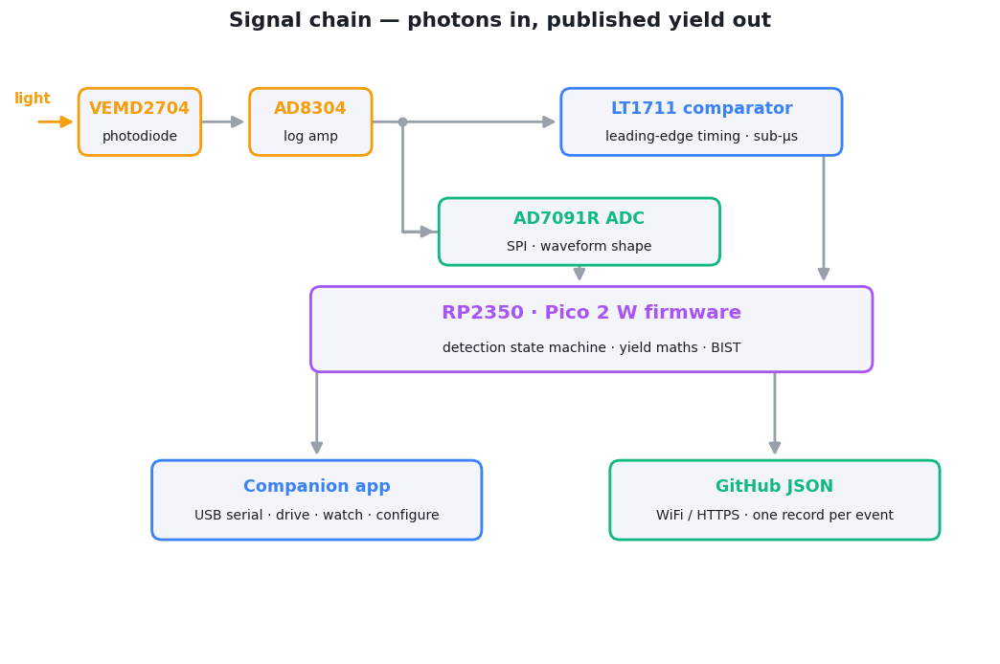
  </picture>
</p>

The comparator's job is onset timestamping only: it captures the sub-µs
leading edge at its 1.03 V threshold (over a ~0.9 V background) and triggers the
ADC capture. Both `t_min` and `t_inter` are then measured from the ADC waveform
using reversal-hysteresis peak/valley detection — because the shallow,
one-decade minimum never recrosses the comparator threshold mid-event for any
in-envelope signal, so the timing cannot be taken from the comparator alone.

A detection therefore requires all of: a fast leading edge, then a
peak → shallow-minimum → second-peak shape on the ADC trace, with `t_inter`
falling in the valid 10 kt – 1 Mt band. That combination rejects the plausible
impostors — none of which reproduce the full sequence:

- **Lightning** — a single peak, typically &lt;50 ms, no slow second hump.
- **Camera flash, welder strike, arc fault** — one fast pulse, no second peak.
- **Sun glint, aircraft strobe** — slow rise, no millisecond-scale leading edge.
- **Meteor / bolide** — one broad envelope, not peak → minimum → peak.

---

## Optical front-end & dynamic range

The photodiode sees a huge range of light: at 5 km a 1 Mt first pulse drives
milliamps of photocurrent, while a far, hazy 10 kt second pulse sits down in the
nanoamps — about seven decades. Rather than switch gain mid-event, the AD8304
logarithmic transimpedance amplifier compresses that whole span onto one analog
output:

```
VLOG = 246 mV × log₁₀(I_pd / 1 pA)      ⇔      I_pd = 10^(VLOG / 0.246 − 12)
```

Both constants follow from the BHG-3000 network at AD8304 datasheet nominals
(200 mV/decade and a 100 pA intercept at `VLOG`, 5 kΩ `VLOG` source resistance,
2.0 V `VREF`). `R2` (24.9 kΩ, `VREF` → `VLOG`) scales the slope by
24.9 / (24.9 + 5) to ≈167 mV/decade and adds ≈0.33 V; the output buffer's gain of
1 + `R4`/`R3` = 1 + 6.34 k / 13.3 k ≈ 1.48 then gives **246 mV/decade** and a
≈0.49 V offset, equivalent to moving the intercept from 100 pA down to ≈1 pA.
(`R1`, 309 kΩ, is not fitted.) These are nominal values, so calibrate against a
known source for absolute work. A fixed **OD 2.0** neutral-density filter (1 %
transmission, effective aperture `A_eff = 1.51 × 10⁻⁸ m²`) pulls the bright
extreme back under the AD8304's 10 mA ceiling. First-pulse saturation is
*accepted*: the comparator has already timestamped the leading edge to sub-µs, and the
log output stays valid through the dimmer, slower second pulse that carries the timing.

Two caveats on the optical model. 
Spectral: the Glasstone & Dolan
pulse-shape data is *total* thermal power, but the unfiltered silicon photodiode
weights ~400–1100 nm, so the in-band peak-to-minimum contrast may differ modestly
from the broadband ten-fold figure. 
Burst height: per G&D §7.85 a contact surface burst behaves like an air burst of 
roughly twice the yield, lengthening the timings ~36 % — one reason the accept window 
carries headroom at the top.

<p align="center">
  <picture><source media="(prefers-color-scheme: dark)" srcset="assets/photocurrent-vs-yield-dark.png">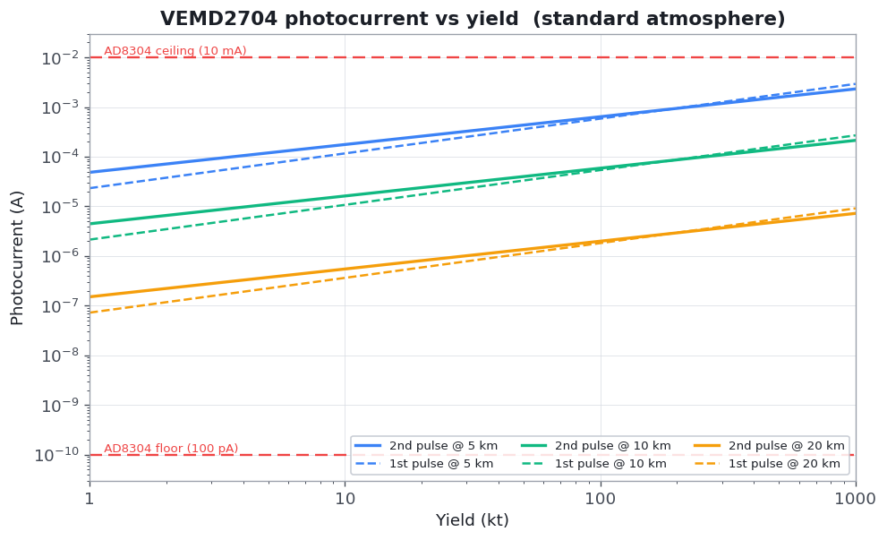</picture>
  <picture><source media="(prefers-color-scheme: dark)" srcset="assets/vlog-vs-yield-dark.png">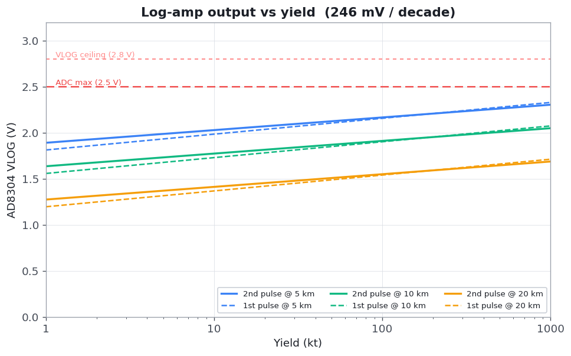</picture>
</p>

Across 10 kt – 1 Mt and 5–20 km the photocurrent stays inside the AD8304's
100 pA – 10 mA window and VLOG stays under the external ADC's 2.5 V reference — one
fixed-gain front-end, no switching. Bandwidth is modest: the first pulse rises in
~100 µs and is a few ms wide, the second pulse is sub-kHz, and the comparator (not the
ADC) carries the fast edge. The whole double pulse lands in one clean trace:

<p align="center">
  <picture>
    <source media="(prefers-color-scheme: dark)" srcset="assets/vlog-waveforms-dark.png">
    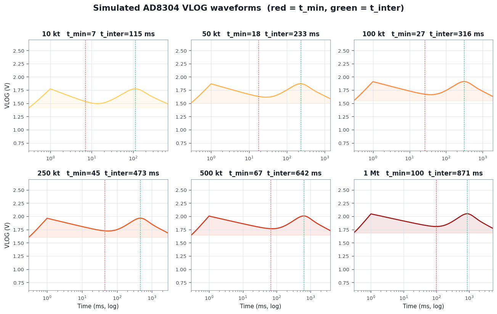
  </picture>
</p>

The literature waveforms make the detection strategy explicit. Mapped through the
repo's amplitude calibration, the VLOG output clears the 1.03 V comparator
threshold (red) well above the 0.9 V background (dashed) on the leading
edge, but the inter-pulse minimum stays **≥ ~1.3 V** at every preset — so the
comparator never recrosses its threshold between the pulses, which is exactly why
the second-peak timing is recovered from the ADC trace rather than a second edge:

<p align="center">
  <picture>
    <source media="(prefers-color-scheme: dark)" srcset="assets/vlog-waveforms-literature-dark.png">
    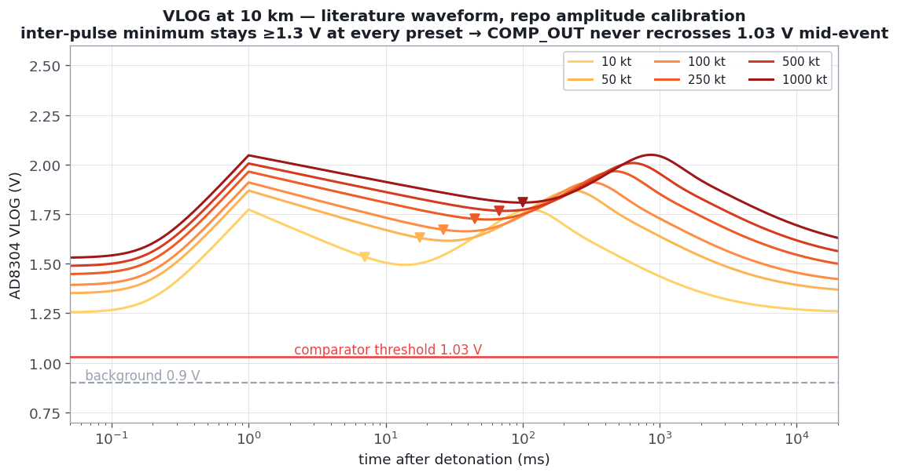
  </picture>
</p>

---

## Repository layout

| Folder | Contents |
|---|---|
| [code/](code) | All software. The [firmware](code/optical_bhang) (RP2350 / Pico 2 W) and the [companion app](code/bhang_companion) (PySide6 desktop operator console). See [code/README.md](code/README.md). |
| [PCB/](PCB) | Hardware design — two boards: the **carrier** ([bhangmeterv3](PCB/bhangmeterv3)) and the **BHG-3000 sensor head** ([BHG-3000](PCB/BHG-3000)). Schematics, assembly drawings + BOMs, and Gerbers. See [PCB/README.md](PCB/README.md). |
| [mech/](mech) | Mechanical / enclosure design — 3D-printable `.3mf` models: `front`, `rear`, `plunger` and `washer`. |

---

## Hardware at a glance

| Block | Part | Why |
|---|---|---|
| Photodiode | **VEMD2704** (Si PIN, ~400–1100 nm) | Both flashes are broadband thermal emission — a near-blackbody continuum across UV, visible, and IR, with the energy-dominant second pulse resembling sunlight (~6000–7000 K) (Glasstone & Dolan §7.23, §7.76). Left deliberately unfiltered so the detector gathers as much of that broadband light as possible. |
| Logarithmic amp | **AD8304** | Log-compresses the photodiode current so one fixed-gain front-end spans the dim baseline up to a saturating first pulse (several decades) — no gain switching mid-event. |
| Edge timing | **LT1711** comparator | Sub-µs timestamp of the leading edge regardless of amplitude (first-pulse saturation is accepted). |
| Waveform capture | **AD7091R** ADC (SPI) | Records the analog shape so peak/minimum/second-peak can be analysed. |
| Compute / comms | **RP2350** (Pico 2 W) | Dual-core: detection + control on core 0 (which also brings WiFi up at boot); the blocking HTTPS uploads and liveness beacon run on core 1. |
| Blast cross-check | Honeywell HSC pressure sensor | *(planned)* overpressure reference to back up the optical yield estimate. |

> **VEMD2704** — 1.51 mm² active area, ~0.40 A/W broadband responsivity, 17.6 pF,
> 70 ns rise, ±67° FOV.

---

## Getting started

1. **Build the hardware** from [PCB/](PCB) and [mech/](mech).
2. **Flash the firmware** — a prebuilt `.uf2` is included, or build from source.
   See [code/optical_bhang/README.md](code/optical_bhang/README.md).
3. **Configure on first boot** over USB serial (WiFi + a GitHub repo to publish
   to). No credentials live in the firmware — they're entered at runtime and
   stored in flash.
4. **Drive and view** the device with the [companion app](code/bhang_companion),
   or read the published JSON from your GitHub repo.

---

## Status & scope

Work in progress. Yield estimation from timing is intrinsically coarse — a 10 %
error in `t_inter` becomes a ~25 % yield error (`W ∝ T^2.27`), which is why the
sharp `t_inter` feature is the primary estimate, `t_min` only a coarse
cross-check, and a blast cross-reference is planned.

The built-in self-test (BIST) emits a square double-flash whose gap is fully
dark, unlike the real signature's shallow one-decade dip; it validates the
signal chain end-to-end but is not a shape-fidelity test of the discriminator (the
corrected analysis accepts both).

The firmware's TLS upload path does not yet verify the server certificate; use a
dedicated, fine-grained GitHub token (see the firmware README's security notes).

## References

- Glasstone, S. & Dolan, P. J. *The Effects of Nuclear Weapons*, 3rd ed., 1977 (chiefly §2.125 and §7.76–7.88).
- Sublette, C. *Nuclear Weapons Frequently Asked Questions* (Nuclear Weapon Archive), §5 — cited above as "NWA FAQ".
- Bridgman, C. J. *Introduction to the Physics of Nuclear Weapons Effects*, DTRA, 2001.
- Brode, H. L. "Fireball Phenomenology," RAND, 1964.
- U.S. AEC, *Capabilities of Nuclear Weapons* (DNA EM-1), declassified excerpts.

[^gd]: Glasstone & Dolan 1977: `t_inter` is the §7.85 second-maximum scaling for
    air bursts below 15,000 ft; `t_min` is a fit through §2.125 (≈11 ms at 20 kt)
    and the NWA FAQ §5 (≈100 ms at 1 Mt).

