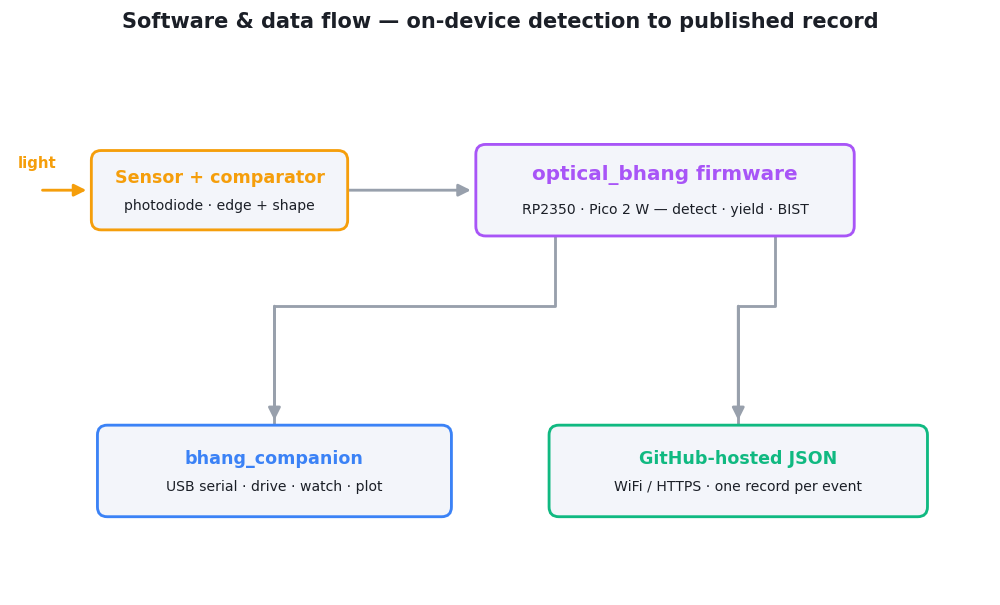

# Optical Bhangmeter

An **optical bhangmeter** — a sensor that watches for the characteristic
**double flash** of a nuclear detonation, estimates the device's **yield** from
the flash timing, and publishes each event to a GitHub-hosted JSON file over
WiFi.

This folder holds the two software components: the on-device **firmware** and a
host-side **companion** application.

## Components

| Folder | What it is |
|---|---|
| [optical_bhang/](optical_bhang) | **Firmware** for the RP2350 (Raspberry Pi Pico 2 W). Detection state machine, ADC waveform capture, yield maths, BIST self-test, and the WiFi → GitHub upload. Built with the Pico SDK + CMake/Ninja. |
| [bhang_companion/](bhang_companion) | **Desktop operator console** (Python / PySide6). Connects to the device over USB serial to arm/disarm it, watch its live state, plot captured waveforms, and edit its stored configuration. |

See each folder's `README.md` for full build / run / configuration instructions.

## How the pieces fit together

  <picture>
    <source media="(prefers-color-scheme: dark)" srcset="../assets/code-dataflow-dark.png">
    
  </picture>

- The **firmware** does all sensing, detection, and yield estimation on board,
  then publishes results to a JSON file in a GitHub repo of your choice.
- The **companion** is the PC-side remote control and viewer over USB serial. It
  never interprets events itself — it drives the device, displays its state, and
  plots the waveforms it streams back.

## Quick start

1. **Firmware** — build and flash to a Pico 2 W, then enter WiFi + GitHub
   credentials over serial on first boot. See [optical_bhang/README.md](optical_bhang/README.md).
2. **Companion** — install the Python deps and run the console to drive the
   device. See [bhang_companion/README.md](bhang_companion/README.md).

## Configuration & secrets

There are **no credentials in the source**. WiFi and GitHub secrets are entered
at runtime over USB serial (`SET` / `SAVE`) and stored only in the device's
flash. Use a **dedicated, fine-grained GitHub PAT** scoped to the single
publishing repo (*Contents: write* only) — see the firmware README's security
notes for the reasoning, including the current TLS-certificate caveat.
