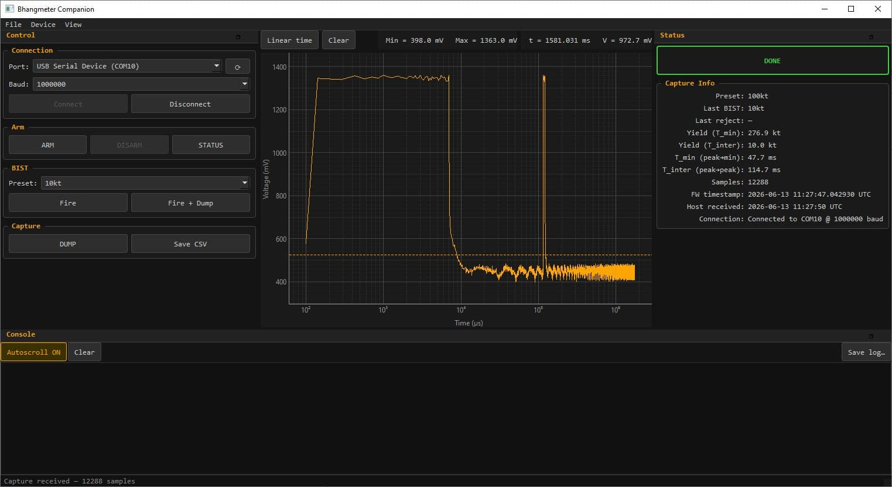

# Bhangmeter Companion

<p align="center">
  <picture>
    
  </picture>
</p>

<p align="center"><em>The companion app — a PySide6 desktop console for driving the device, watching its state, and plotting captured waveforms.</em></p>

Desktop operator console for the RP2350-based [optical bhangmeter](../optical_bhang).
It connects to the device over a USB CDC serial link (a virtual COM port)
and lets you:

- issue control commands — arm, disarm, run a self-test (BIST), request a dump;
- watch the device's live state — idle, armed, capturing, analysing, done;
- plot the waveform the device streams back after a capture;
- read and write the device's stored configuration (WiFi, location, GitHub
  upload target).

The device does all detection and yield maths on board; the Companion is a
window onto that work plus a remote control for it.

---

## Requirements

- **Python 3.11 or 3.12** for the pinned `requirements.txt` (PySide6 6.7.2 and
  numpy 1.26.4 have no builds for 3.13+). On a newer Python, install the
  unpinned packages instead — see below.
- **PySide6** (Qt GUI + `QtSerialPort`), **pyqtgraph** (plotting), **numpy**
- **pyserial** — *optional*; only used for richer serial-port descriptions, with
  an automatic fallback to Qt's own port enumeration if it is absent.

## Install

```sh
python -m venv .venv
.venv\Scripts\activate            # Windows
# source .venv/bin/activate       # macOS/Linux

pip install -r requirements.txt   # pinned set
# or the minimal runtime deps:
# pip install PySide6 pyqtgraph numpy
```

(`requirements.txt` lists only runtime dependencies; `pyserial` is the one
optional entry.)

## Run

This folder is the `bhang_companion` Python package, so launch it from the
parent directory with `-m`:

```sh
cd ..                 # into the directory that contains bhang_companion/
python -m bhang_companion
```

Running from *inside* this folder will fail — Python needs `bhang_companion` to
be importable as a top-level package, which it is from the parent.

On startup the app loads its dark theme, scans for serial ports, and
auto-connects to a port described as "USB Serial Device" — how the Pico appears
on Windows. On macOS/Linux, pick the port and press Connect.

The BIST buttons are enabled only when the device is `IDLE` or `DONE`; it boots
`ARMED`, so press DISARM first.

## Offline mode

**File → Open CSV** loads a previously saved DUMP file through the same parser
used for live captures — no device or serial connection needed.

---

## Serial / configuration protocol

All commands are plain-text lines terminated by `\n` (or `\r`); the verb is
case-insensitive and the device echoes each line before replying.

**Control:** `ARM`, `DISARM`, `STATUS`, `DUMP`, `HELP`, `BIST <preset>`
(presets: `10kt 50kt 100kt 250kt 500kt 1mt`).

**Configuration:**

| Command | Effect | Success reply |
|---|---|---|
| `SET <key> <value>` | Edit one field in the live RAM copy — **rejected unless `IDLE`** (DISARM first), except during first-boot config mode | `OK` |
| `SHOW` | Print every field (secrets masked) | `CONFIG:` + one line per field |
| `SAVE` | Persist to flash — **rejected unless `IDLE`** (DISARM first) | `OK SAVED` |
| `CLEAR` | Factory reset (takes effect next boot) — **rejected unless `IDLE`** (DISARM first) | `OK CLEARED` |

Config keys: `wifi_ssid`, `wifi_pass`, `device_id`, `lat`, `lon`, `gh_user`,
`gh_repo`, `gh_branch`, `gh_file`, `gh_token`, `ntp`. `wifi_pass` and `gh_token`
are **secret** — `SHOW` masks them (first two + `...` + last two chars), so the
GUI keeps its own copy as the source of truth for save/restore.

`SET` edits only RAM; nothing is permanent until `SAVE`. Both are gated to `IDLE`
(outside first-boot config mode): a flash write cannot run during a capture, and
core 1 may read the config mid-upload, so the device must be disarmed before
editing or saving. The companion's config push therefore sends `DISARM` first,
then the `SET`s, then `SAVE`, and re-arms if the device was armed beforehand.
New WiFi settings take effect on the next reboot or reconnect.

The console shows everything sent and received, **including `SET wifi_pass` and
`SET gh_token` lines in clear text**, and "Save log" writes them to disk. The
config dialog's "Save to file" likewise stores secrets as plain JSON.

> **USB CDC ignores the baud rate** and runs at native USB speed. The baud
> dropdown in the UI is only for users on a UART-to-USB debug probe (e.g.
> Picoprobe).

---

## Layout

| Module | Role |
|---|---|
| [protocol.py](protocol.py) | Pure functions + dataclasses (command formatters, line parser, `DumpAssembler`). No Qt — unit-testable on its own. |
| [serial_worker.py](serial_worker.py) | `QObject` owning one `QSerialPort`; turns incoming bytes into one signal per line. |
| [main_window.py](main_window.py) | Owns the worker + `DumpAssembler` and wires everything together. |
| [widgets/](widgets/) | The UI panels (console, control panel, status panel, waveform plot, config dialog). |
| [styles/coldwar.qss](styles/coldwar.qss) | Dark "Cold War" theme (optional — the app runs without it). |
